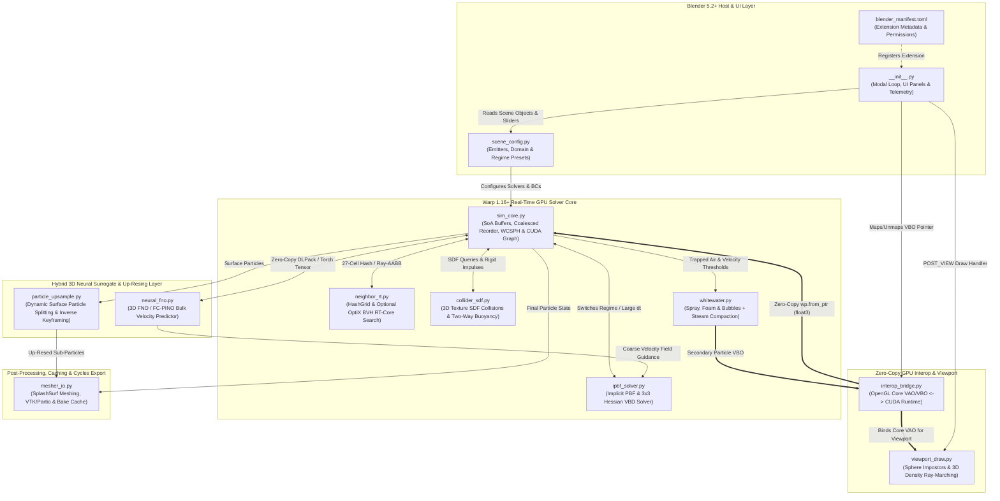

# WarpSPH Realtime: Final Add-on Architecture & Companion Guide

This document outlines the complete file architecture, module connections, and research foundations for the **Warp 1.16+ & Blender 5.2+ Hybrid Real-Time Fluid & Neural Add-on**.

---

## 1. Architecture Mermaid Diagram

---

## 2. File Summaries, Connections & Research Sources

### A. Blender 5.2+ Host & UI Layer
* **`blender_manifest.toml` (Implemented)**
  * **Summary:** Defines the Blender 5.2+ extension schema (`1.0.0`), minimum Blender version (`5.2.0`), Python 3.13 wheel compatibility, and OS/file permissions.
  * **Connections:** Read by Blender's extension manager at startup to load `__init__.py`.
  * **Sources:** Blender 5.2 LTS Manual & Developer Extension Guidelines (Manifest Schema 1.0.0, Python Wheels, and Add-ons) [Source 1, Source 6, Source 8].
* **`__init__.py` (Implemented)**
  * **Summary:** Hosts the modal timer operator (`WM_OT_warp_sph_start`), the dynamic GPU buffer manager, and the 3D Viewport sidebar panel (`VIEW3D_PT_warp_sph`) with live FPS/VRAM telemetry.
  * **Connections:** Orchestrates the per-frame zero-copy loop between `interop_bridge.py`, `sim_core.py`, and `viewport_draw.py`, and syncs timeline/scene state.
  * **Sources:** Blender 5.2 GPU & Viewports Draw Manager documentation and SplatBus dynamic viewport timeline synchronization [Source 6, Source 8, Source 12].
* **`scene_config.py` (Planned - Phase 2)**
  * **Summary:** Translates Blender mesh objects, fluid blocks, emitters, and physical regime presets (e.g., pouring milk vs. underwater shockwaves) into validated solver configurations.
  * **Connections:** Feeds initial particle distributions, domain boundaries, and modular operator selections into `sim_core.py` and `collider_sdf.py`.
  * **Sources:** CraftSPH composable configuration validation and modular SPH workflow ("Prepare Scene" phase) [Source 5, Source 7].

### B. Zero-Copy GPU Interop & Viewport Rendering
* **`interop_bridge.py` (Implemented)**
  * **Summary:** Allocates strict OpenGL 4.5+ Core Profile Vertex Array Objects (VAOs) and Vertex Buffer Objects (VBOs) inside Blender 5.2, registers them with CUDA (`cudaGraphicsGLRegisterBuffer`), and wraps raw device pointers into `wp.array` via `wp.from_ptr`.
  * **Connections:** Bridges `sim_core.py` and `whitewater.py` directly to Blender's OpenGL draw context without CPU readback.
  * **Sources:** Blender 5.2 GPU Viewport & OpenGL/Vulkan Backend abstractions and GPU interprocess/shared-buffer communication [Source 6, Source 8, Source 12].
* **`viewport_draw.py` (Planned Extraction from `__init__.py`)**
  * **Summary:** Upgrades the baseline `GL_POINTS` draw call to screen-space shaded sphere impostors, velocity/density color-mapping, and optional 3D density texture volumetric ray-marching.
  * **Connections:** Consumes the VAO/VBO handles from `interop_bridge.py` during Blender's `POST_VIEW` callback.
  * **Sources:** Blender 5.2 Shading Language (`gpu.shader`) and SplatBus viewport overlay/compositor integration [Source 6, Source 12].

### C. Warp 1.16+ Real-Time GPU Solver Core
* **`sim_core.py` (Implemented)**
  * **Summary:** Manages Structure of Arrays (SoA) GPU buffers, executes $O(n)$ spatial hashing (`wp.HashGrid`), performs explicit cell-sorted SoA particle reordering (`k_reorder_soa`), and launches single-pass WCSPH + copy-back inside a captured Warp 1.16+ CUDA Graph (`wp.ScopedCapture`).
  * **Connections:** Acts as the central physics hub, calling `neighbor_rt.py`, `ipbf_solver.py`, `collider_sdf.py`, and `whitewater.py`.
  * **Sources:** Modular SPH operator pipelines (gravity, viscosity, pressure, and symplectic Euler integration) and adaptive workload balancing at high particle counts [Source 5, Source 7, Source 13].
* **`ipbf_solver.py` (Planned - Phase 2)**
  * **Summary:** Implements Implicit Position-Based Fluids (IPBF) and Extended Position-Based Dynamics (XPBD) constraints using local $3 \times 3$ Hessian inversions (Vertex Block Descent) for unconditional stability under large interactive time steps and multi-phase densities.
  * **Connections:** Plugs into `sim_core.py` as an artist-selectable solver regime alongside WCSPH.
  * **Sources:** Blender 5.2 XPBD Solver architecture, PBF/IISPH integration notes, and multi-phase fluid density support [Source 4, Source 6, Source 7, Source 13].
* **`neighbor_rt.py` (Planned - Phase 4 Optional Backend)**
  * **Summary:** Provides an alternative neighbor search backend that constructs an OptiX Bounding Volume Hierarchy (BVH) over particle AABBs to leverage hardware Ray Tracing (RT) cores for highly non-uniform particle distributions.
  * **Connections:** Swaps seamlessly with `wp.HashGrid` inside `sim_core.py`.
  * **Sources:** RTNN (`optixNSearch`) and hardware RT-core Acceleration Structure Traversal (AST) for particle simulations [Source 3, Source 10].
* **`collider_sdf.py` (Planned - Phase 2)**
  * **Summary:** Evaluates arbitrary Blender collider meshes using precomputed 3D Signed Distance Field (SDF) textures (`wp.Mesh` / 3D textures) and computes pressure-integrated two-way buoyancy forces on rigid bodies.
  * **Connections:** Exchanges particle boundary impulses with `sim_core.py` and writes rigid-body transforms back to Blender scene objects.
  * **Sources:** Arbitrary mesh SDF evaluation via 3D textures and pressure-integrated buoyancy using the SPH density field [Source 7, Source 13].
* **`whitewater.py` (Planned - Phase 3)**
  * **Summary:** Spawns and advects secondary diffuse particles (ballistic spray, surface foam, and buoyant submerged bubbles) classified by local fluid neighbor count ($n_f$) and compacted on the GPU.
  * **Connections:** Reads fluid velocities and neighbor counts from `sim_core.py` and writes active secondary positions to a second zero-copy VBO in `interop_bridge.py`.
  * **Sources:** Multi-particle system influences and modular particle type management [Source 5, Source 8, Source 13].

### D. Hybrid 3D Neural Surrogate & Up-Resing Layer
* **`neural_fno.py` (Planned - Phase 4)**
  * **Summary:** Runs 3D Fourier Neural Operators (`neuraloperator` / `FC_PINO` / `AFNO`) and Derivative-Informed DeepONets (`DI-DeepONet`) in PyTorch (Python 3.13 compatible) to predict coarse bulk velocity/pressure fields and accelerate time-stepping.
  * **Connections:** Shares zero-copy GPU memory with `sim_core.py` via DLPack (`wp.to_torch`) to guide `ipbf_solver.py`.
  * **Sources:** `neuraloperator` (Python 3.13 workflow), FourCastNet AFNO backbone, 3D Fourier Continuation PINO (`FC_PINO`), and `DI-DeepONet` [Source 2, Source 9, Source 14, Source 15].
* **`particle_upsample.py` (Planned - Phase 4)**
  * **Summary:** Performs online dynamic particle splitting near free surfaces and supports differentiable inverse keyframing using PyTorch autograd/Warp tape.
  * **Connections:** Refines coarse particles from `sim_core.py` before passing high-resolution point clouds to `mesher_io.py`.
  * **Sources:** Differentiable composable SPH (`CraftSPH`) and hierarchical multipole/local near-field particle evaluations [Source 5, Source 11].

### E. Post-Processing, Caching & Cycles Export
* **`mesher_io.py` (Planned - Phase 4)**
  * **Summary:** Handles non-sequential disk baking, VTK/Paraview diagnostic export, and `SplashSurf` surface reconstruction to generate watertight polygon meshes for final rendering in Blender Cycles (with Texture Cache & Thin Wall BSDF).
  * **Connections:** Reads GPU/cached particle buffers from `sim_core.py` and `particle_upsample.py` and writes native Blender Mesh/Cache data-blocks.
  * **Sources:** Blender 5.2 Simulation Nodes disk baking, CraftSPH VTK data output, and SplashSurf surface reconstruction for Blender rendering [Source 1, Source 4, Source 5, Source 7].
