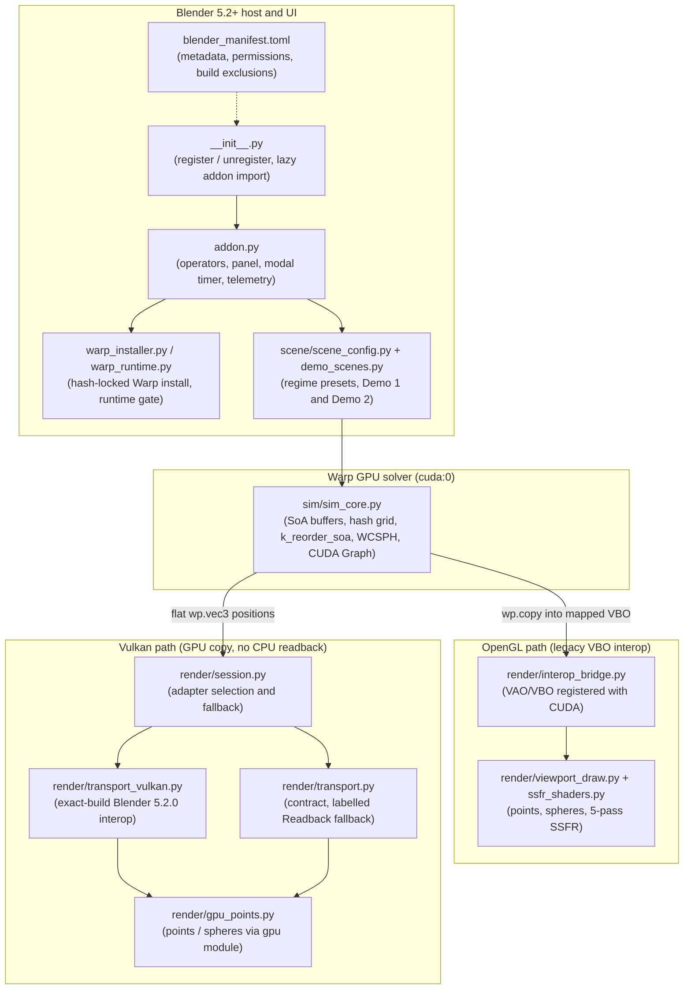

# WarpSPH Realtime: Architecture

This document describes what the built extension ships. Planned and research modules live in
`warp_sph_realtime/experimental/` and are listed separately at the end; they are not part of the
built zip.

---

## 1. Shipped architecture

Transport selection follows `gpu.platform.backend_type_get()` (what is running). Terminology: the
OpenGL and Vulkan paths keep particle data in GPU memory with no CPU readback ("zero host-copy").
They are not zero GPU copy; see the top of [`VULKAN_ZERO_COPY_PLAN.md`](./VULKAN_ZERO_COPY_PLAN.md).

## 2. Shipped modules

| Module | Role |
|---|---|
| `blender_manifest.toml` | Extension metadata (schema 1.0.0, Blender 5.2.0+), `files` and `network` permissions, tags, build exclusions (`experimental/` is not zipped). |
| `__init__.py` | `register()` / `unregister()` only; imports `addon` lazily so the extension registers without Warp. |
| `addon.py` | Operators, sidebar panel, scene properties, modal timer and telemetry; imports CUDA modules only on Start. |
| `warp_installer.py`, `warp_runtime.py`, `warp_wheels.lock.json` | SHA-256-locked `warp-lang==1.17.0` (CUDA 12.9) install into extension storage and the runtime gate. |
| `sim/sim_core.py` | `RealtimeWCSPHSolver`: SoA buffers, `wp.HashGrid`, `k_reorder_soa`, cubic-spline WCSPH, SDF obstacle collisions, CUDA Graph capture. |
| `scene/scene_config.py`, `scene/demo_scenes.py` | Regime presets (`WATER`, `MILK`, `SHOCKWAVE`) and the two demo scenes (`DOUBLE_DAM_PILLARS`, `BLOCK_FLOP_SPLASH`). |
| `render/interop_bridge.py` | OpenGL VAO/VBO creation and `cudaGraphicsGLRegisterBuffer` mapping (legacy SSFR/spheres path), plus the cudart/GL seam for the GLInterop texture adapter. |
| `render/transport_gl.py` | GLInterop texture adapter for Points on the OpenGL backend: pack kernel, `cudaGraphicsGLRegisterImage`, GPU copy into a `GPUTexture`, no CPU readback; falls back once to labelled Readback. |
| `render/viewport_draw.py`, `render/ssfr_shaders.py` | OpenGL draw callbacks: points, spheres and the SSFR liquid renderer. |
| `render/session.py`, `render/transport.py` | Transport session owner and contract; Vulkan tries the exact-build adapter and OpenGL (Points mode) the GLInterop texture adapter; each falls back once to the labelled Readback transport. |
| `render/transport_vulkan.py`, `render/blender_symbols*.py`, `render/profiles/` | Vulkan CUDA interop for the exact certified Blender 5.2.0 build, with symbol resolution profiles. |
| `render/gpu_points.py` | Backend-neutral points/spheres draw via Blender's `gpu` module. On Vulkan, SSFR mode shows spheres with a note; SSFR is OpenGL-only. |

## 3. Experimental (not shipped)

These modules are in the repository under `warp_sph_realtime/experimental/` and are excluded from
the built zip. None is wired into the UI or runtime.

| Module | Intent |
|---|---|
| `ipbf_solver.py` | Implicit position-based fluids (IPBF) kernels. |
| `collider_sdf.py` | Analytical / SDF collider kernels. |
| `whitewater.py` | Spray, foam and bubble classification and advection. |
| `neighbor_rt.py` | Neighbor-search abstraction (`wp.HashGrid`; OptiX BVH is a future idea). |
| `neural_fno.py` | DLPack bridge for 3D Fourier neural operators. |
| `particle_upsample.py` | Free-surface particle detection for splitting. |
| `mesher_io.py` | Disk export and SplashSurf reconstruction wrapper. |
| `differentiable_pour.py`, `keyframe_pour.py` | Differentiable-pour and keyframe studies (results in `DIFFERENTIABLE_POUR_*.md`, `KEYFRAME_*.md`, `CONTACT_CORRECTION_RESULTS.md`). |

Research background for these ideas is in [`RESEARCH.md`](./RESEARCH.md).
