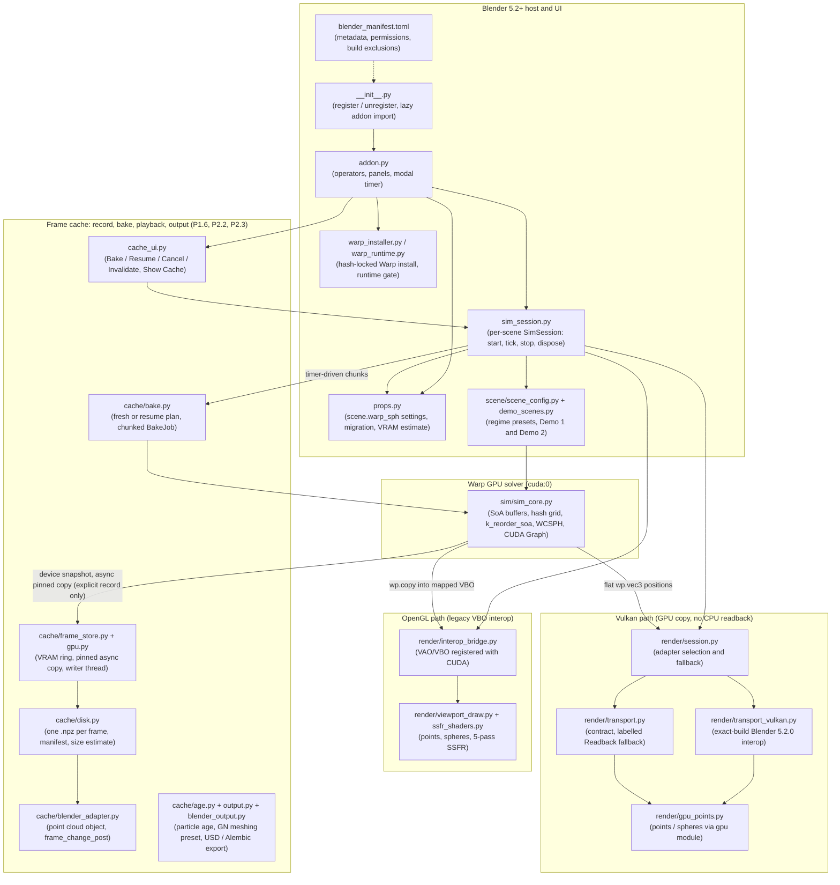

# WarpSPH Realtime: Architecture

This document describes what the built extension ships. Planned and research modules live in
`warp_sph_realtime/experimental/` and are listed separately at the end; they are not part of the
built zip.

---

## 1. Shipped architecture

Transport selection follows `gpu.platform.backend_type_get()` (what is running). Terminology: the
OpenGL and Vulkan paths keep particle data in GPU memory with no CPU readback ("zero host-copy").
They are not zero GPU copy; see the top of [`VULKAN_ZERO_COPY_PLAN.md`](./VULKAN_ZERO_COPY_PLAN.md).

## 2. Shipped modules

| Module | Role |
|---|---|
| `blender_manifest.toml` | Extension metadata (schema 1.0.0, Blender 5.2.0+), `files` and `network` permissions, tags, build exclusions (`experimental/` is not zipped). |
| `__init__.py` | `register()` / `unregister()` only; imports `addon` lazily so the extension registers without Warp. |
| `addon.py` | Thin UI: operators, panels (main and Advanced) and the modal timer, which call the scene's `SimSession`; registers `scene.warp_sph` and the `load_post` migration; imports CUDA modules only on Start (`_activate_runtime`). |
| `props.py` | `WARPSPH_SceneSettings` (`scene.warp_sph`, stiffness stored in thousands), the one-time migration of the old flat `scene.warp_sph_*` properties, and the GPU memory estimate and warning. |
| `sim_session.py` | `SimSession`, one per scene: all runtime state (solver, transport session or legacy VBO, draw handler, timer, telemetry) with `start` / `tick` / `stop` / `dispose`, transactional reallocation, quarantine on fatal errors. One run per process; `process_state()` flags survive add-on reloads. While a bake runs (`begin_bake`), `tick` hands each timer event to the `BakeJob` instead of stepping live, publishes the latest state to the viewport once per chunk, and `stop` drains and drops the job. |
| `cache_ui.py` | Record / Bake Cache sub-panel and operators (Bake, Resume, Cancel, Invalidate from the current frame, Delete, Show Cache as Point Cloud). The only `bpy` consumer of `cache/` besides the add-on registration; the bake itself is `SimSession.begin_bake`. |
| `cache/disk.py` | `DiskCache`: one plain `.npz` per frame (`position`, `velocity`, `id`) plus `manifest.json` (bake signature). Atomic writes (`.tmp` then rename), contiguous-range scan, invalidate-from-frame, exact size estimate, default folder (next to the saved .blend, temp when unsaved). NumPy only. |
| `cache/gpu.py` | `VramRing` (device snapshot slots, pinned host arrays, second stream and events) and `SolverSource` (steps the solver into a slot, restores a cached state for resume). Warp is passed in, never imported. Recording is an explicit user action: a host copy is allowed here and never in a live transport. |
| `cache/frame_store.py` | `FrameStore`: ring + disk behind one writer thread. Non-blocking `acquire` / `pump`; files always form a prefix of the timeline. |
| `cache/bake.py` | `plan_bake` (fresh or resume after the last intact frame, signature check) and `BakeJob`, a state machine doing a time-budgeted chunk per timer tick (never a blocking loop); cancel and failure leave whole frames only. |
| `cache/blender_adapter.py` | `bpy` module of `cache/`: the playback `PointCloud` object (`velocity`, `id`, `age`, `radius`; renders in Cycles) and its `frame_change_post` handler. |
| `cache/age.py` | `EmissionIndex`: first cached frame of every particle id, scanned incrementally from the id arrays (no cache format change; rolled back when a frame file changes), and `seconds_per_frame` from the bake signature. NumPy only. |
| `cache/output.py` | Pure numbers for output: meshing defaults from the particle spacing, export file extension and baked-only frame range. |
| `cache/blender_output.py` | `bpy` module of `cache/`: the "WarpSPH Meshing" node group and mesh object (Object Info -> Points to Volume -> Volume to Mesh -> Blur Attribute -> Set Shade Smooth -> Set Material), and the USD / Alembic export of the baked range. |
| `warp_installer.py`, `warp_runtime.py`, `warp_wheels.lock.json` | SHA-256-locked `warp-lang==1.17.0` (CUDA 12.9) install into extension storage and the runtime gate. `plan_install` (main thread, reads Blender) and `run_plan` (no `bpy`, cancellable: temp download or verified local-wheel copy, then atomic promotion) split the install; the Warp source (download / local wheel / existing folder, P1.11) selects the single directory Warp may be imported from, and the foreign-Warp guard accepts only that one. |
| `install_job.py` | Pure-Python worker thread for `run_plan` with a lock-protected progress snapshot and a cancel flag (P1.4). |
| `install_ui.py` | Preferences UI: Warp source, progress bar and Cancel (polled by a `bpy.app.timers` timer), first-run hardware check panel, install/cancel operators. The only `bpy` consumer of `install_job`. |
| `diagnostics.py` | Diagnostics report, log setup, and the pre-Warp hardware probe (`nvidia_smi_info`, `hardware_summary`). |
| `sim/sim_core.py` | `RealtimeWCSPHSolver`: SoA buffers, `wp.HashGrid`, `k_reorder_soa`, cubic-spline WCSPH, CUDA Graph capture; in scene mode the particle pool, emission and animated-collider poses (section 2.1). Every step rewrites `pos_sim` / `vel` in spatial-sort order, so the array index is not a particle identity; `pid` (carried through the same sort by `k_reorder_soa_id` over the active count, outside the graph; `k_emit` gives each emitted particle a fresh id) is the stable id the cache stores. |
| `sim/colliders.py` | `MeshSet`: one `wp.Mesh` per collider, stored relative to its pivot; signed distance from the closest face's pseudo-normal, deep "inside" answers confirmed by the winding number. |
| `scene/description.py` | Pure-NumPy scene contract: `SceneDescription`, `MeshData`, `EmitterData`, `ColliderMotion`, validation, rigid keys (`rigid_key`). |
| `scene/fill.py`, `scene/emitters.py` | Lattice fill of fluid volumes; emitter nozzle lattice and the GPU filter that keeps nozzles clear of walls and colliders. |
| `scene/blender_scene.py` | The only `bpy` reader of authored scenes: roles, evaluated meshes, unit scale, gravity, frame rate, emitter settings, animated colliders, and `sync_collider_keyframes`. |
| `scene/scene_config.py`, `scene/demo_scenes.py`, `scene/demo_description.py` | Regime presets (`WATER`, `MILK`, `SHOCKWAVE`) and the two demo scenes (`DOUBLE_DAM_PILLARS`, `BLOCK_FLOP_SPLASH`); the demos run through the scene path with their pillars and sphere as one mesh collider. |
| `render/interop_bridge.py` | OpenGL VAO/VBO creation and `cudaGraphicsGLRegisterBuffer` mapping (legacy VBO path), plus the cudart/GL seam for the GLInterop texture adapter. |
| `render/transport_gl.py` | GLInterop texture adapter for Points on the OpenGL backend: pack kernel, `cudaGraphicsGLRegisterImage`, GPU copy into a `GPUTexture`, no CPU readback; falls back once to labelled Readback. |
| `render/viewport_draw.py`, `render/ssfr_shaders.py` | Legacy OpenGL VBO draw callbacks: points, spheres and the raw-GL SSFR liquid renderer. |
| `render/session.py`, `render/transport.py` | Transport session owner and contract; Vulkan tries the exact-build adapter and OpenGL (Points mode) the GLInterop texture adapter; each falls back once to the labelled Readback transport. |
| `render/transport_vulkan.py`, `render/blender_symbols*.py`, `render/profiles/` | Vulkan CUDA interop for the exact certified Blender 5.2.0 build, with symbol resolution profiles. |
| `render/gpu_points.py` | Backend-neutral points/spheres draw via Blender's `gpu` module, and the scene-to-`DrawSettings` mapping. |
| `render/gpu_ssfr.py` | Backend-neutral SSFR via the `gpu` module (depth impostors, narrow-range filter, half-res thickness, depth-tested composite); `ViewportRenderer` is the session default and dispatches SSFR vs points/spheres. |

### 2.1 Authored scenes (scene mode)

`description_from_blender` (main thread) turns the tagged objects into a `SceneDescription` in metres:
geometry times `scene.unit_settings.scale_length`, `scene.gravity` as is (Blender stores it in m/s^2),
the frame rate and start frame. `RealtimeWCSPHSolver.from_scene` fills the fluid volumes and calls
`set_scene`. The demos build their description in `demo_description.py` and take the same path.

* **Particle pool.** With emitters the solver allocates `scene.warp_sph.max_particles` slots once at
  Start; without emitters the pool is exactly the fill. The live count is a one-element device array
  (`active`) that the captured kernels read; free slots are parked far outside the domain and every scene
  kernel returns early past the count. The hash grid is rebuilt over the live prefix each substep,
  outside capture, so the CUDA graph never changes.
* **Emission.** Nozzles (one per spacing of emitter surface, filtered to sit at least
  `spacing + max_speed * dt` from walls and colliders) are uploaded once. Before each substep the host
  works out how many particles are due from the rate and frame range and launches `k_emit` into the next
  free slots; when the pool is full, emission stops and the panel and a warning say so. `k_emit` also writes
  each new particle's id from a host-side counter (no readback: the host already knows how many it emitted),
  so the ids of the live particles stay unique (0 ... count - 1, since particles are never removed). A bake
  records the active count per frame into a ring sized for the whole pool; resume restores that count, the
  emitters' progress and the clock (`RealtimeWCSPHSolver.restore_state`).
* **Animated colliders.** A collider with an action, drivers, constraints or an animated parent is moved
  by a rigid transform, never by rebuilding its mesh. Each Blender frame's world matrix is read once on the
  main thread (`sync_collider_keyframes`, which also moves the timeline to the simulation frame) and written
  into an 8-frame key ring on the device. Before each substep `k_collider_motion` interpolates the pose
  (lerp and slerp) into the `collider_xform` buffer and derives the linear and angular velocity, which the
  boundary response uses as the wall velocity. A key with scale or shear stops the run with an error;
  deforming meshes keep their Start-frame shape.
* **Kernels.** Scene mode runs `k_scene_density`, `k_scene_forces` and `k_scene_boundaries` (domain walls
  and colliders). The original kernels (analytic pillars and sphere, `enable_obstacles`) are unchanged and still serve a
  solver without a scene; the add-on no longer uses them.
* **Output.** `copy_positions` scales metres back to scene units for the viewport.

### Recording cost and threading

Recording (`cache/`) is an explicit user action, so a host copy is allowed there; the live transports above stay readback-free. Per frame the solver stream does three device-to-device copies (position, velocity, id, 28 bytes per particle) into a ring slot. A second stream then copies the slot to pinned host memory and records an event; the main thread only polls `Event.is_complete` (never waits), and one writer thread turns finished slots into `.npz` files in frame order, so the files are always a prefix of the timeline. A bake advances a frame in slices of at most 4 solver steps per timer event (4 ms budget), so a tick costs about the same however many steps a frame needs. Measured (RTX 4080 SUPER, Windows): about 7 to 8 ms per frame of added time at 66 steps per frame; at few steps per frame the disk (about 500 to 650 MB/s) is the limit, and a full ring makes the next call return without capturing (backpressure), never block.

## 3. Experimental (not shipped)

These modules are in the repository under `warp_sph_realtime/experimental/` and are excluded from
the built zip. None is wired into the UI or runtime.

| Module | Intent |
|---|---|
| `ipbf_solver.py` | Implicit position-based fluids (IPBF) kernels. |
| `collider_sdf.py` | Analytical / SDF collider kernels. |
| `whitewater.py` | Spray, foam and bubble classification and advection. |
| `neighbor_rt.py` | Neighbor-search abstraction (`wp.HashGrid`; OptiX BVH is a future idea). |
| `neural_fno.py` | DLPack bridge for 3D Fourier neural operators. |
| `particle_upsample.py` | Free-surface particle detection for splitting. |
| `mesher_io.py` | Disk export and SplashSurf reconstruction wrapper. |
| `differentiable_pour.py`, `keyframe_pour.py` | Differentiable-pour and keyframe studies (results in `DIFFERENTIABLE_POUR_*.md`, `KEYFRAME_*.md`, `CONTACT_CORRECTION_RESULTS.md`). |

Research background for these ideas is in [`RESEARCH.md`](./RESEARCH.md).
